# AI Production Pipeline
### by One Two Film

A set of **Claude Code skills** for making AI-generated films, ads and promos:
from the brief and the research, through identity-locked references, frames and
video clips, to the edit, the finished files and the delivery package.

The skills are tool-agnostic. You can connect an image or video generator
through a **CLI**, an **API** or an **MCP connector**, or connect nothing and
generate by hand. In manual mode the pipeline still collects your references,
sorts them into folders and hands you every prompt with the exact references
to attach.

> No keys, accounts or personal data are included in this repository, and none are ever written by the skills. See [SECURITY.md](SECURITY.md).

---

## What it does

Twelve stages, from the brief to the delivered file. Each stage has its own small skills; each skill does one job. Click a stage to jump to its skills.

<table>
<tr><td width="33%" valign="top"><a href="#01-setup"></a><br><b>01 · Project setup</b><br><sub>One project folder, a brief with the deliverables, a backend that can generate (or manual mode).</sub></td><td width="33%" valign="top"><a href="#02-research">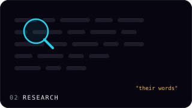</a><br><b>02 · Research</b><br><sub>The audience's own words, real facts and the theme, before anything is written.</sub></td><td width="33%" valign="top"><a href="#03-story"></a><br><b>03 · Story and script</b><br><sub>A finished script, with every scene's places, people and props pulled out of it.</sub></td></tr>
<tr><td width="33%" valign="top"><a href="#04-references"></a><br><b>04 · References and identity</b><br><sub>Every reference sorted and given a job: look, face, room, prop. Characters locked before any shot.</sub></td><td width="33%" valign="top"><a href="#05-shots"></a><br><b>05 · Shot list and storyboard</b><br><sub>Every shot numbered, sized for a reason, with its references and its continuity state.</sub></td><td width="33%" valign="top"><a href="#06-stills"></a><br><b>06 · Still frames</b><br><sub>Prompts in the locked style, frames generated in batches, every file logged with its prompt.</sub></td></tr>
<tr><td width="33%" valign="top"><a href="#07-qc"></a><br><b>07 · Frame QC</b><br><sub>Fresh eyes on every batch, faces checked, failures fixed or rejected.</sub></td><td width="33%" valign="top"><a href="#08-video">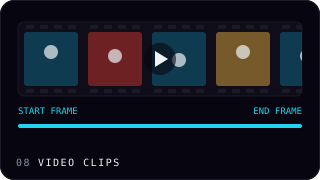</a><br><b>08 · Video prompts and clips</b><br><sub>Approved frames animated: one standalone prompt per shot, clips that join without jumps.</sub></td><td width="33%" valign="top"><a href="#09-edit"></a><br><b>09 · Edit, sound and color</b><br><sub>Material in editor bins, a cut on the timeline, dialogue, music and grade finished.</sub></td></tr>
<tr><td width="33%" valign="top"><a href="#10-finals"></a><br><b>10 · Finals and verification</b><br><sub>The encoded file checked, finals sorted by category, title, aspect and language.</sub></td><td width="33%" valign="top"><a href="#11-delivery"></a><br><b>11 · Delivery and archive</b><br><sub>Packages checked for the client or platform, then the project archived and the drive cleaned.</sub></td><td width="33%" valign="top"><a href="#12-promo"></a><br><b>12 · Promos, trailers and motion</b><br><sub>A side track: films, trailers, posters, presentations and motion graphics made from the project.</sub></td></tr>
</table>

Stages 2 and 12 are optional. The `visual-story-1` … `visual-story-8` skills are an alternative fixed, linear track through the same stages.

**Highlights**
- **Identity lock:** the same face at every age or stage of a character, from reference sheets.
- **Continuity ledgers:** camera, weather, props and wardrobe stay consistent from shot to shot.
- **Cinematic look:** a period-cinema prompt style (anamorphic, shallow depth of field, motivated light) that avoids the glossy "AI poster" look.
- **"Change to" chaining:** close-ups and next moments are re-framed from a master frame. Only frames made this way are used as first + last video pairs.
- **Manual generation pack** (`manual-image-pack`): one folder per frame with `PROMPT.txt`, the reference images already copied in and numbered, and an `INFO.txt`. When you drop `RESULT_1.png` into the folder, the skill checks it, crops thin black bars, files it into the project and updates the storyboard and the video prompts.
- **Keyframe chains:** micro-stories and time-of-day transitions as K1 → K2 → K3 stills, each generated from the previous one, so a video model can play them as first + last frame pairs. Physical realism and forward-moving time are checked.
- **Small, single-purpose QC skills:** contact-sheet QC with scripts, a catalogue of failure → fix lines, a head-only identity fix, and worker/rate-limit discipline. Each one does one job, so the pipeline stays stable.
- **Motion-graphics add-on:** Remotion code route plus video route, for charts and explainers.

---

## Install

You need [Claude Code](https://docs.claude.com/en/docs/claude-code/overview). The bundled helper scripts need Python 3 with Pillow (`pip install pillow`).

**macOS / Linux / Git Bash / WSL**
```bash
git clone https://github.com/teen-boop/AiProductionPipeline.git
cd AiProductionPipeline
./install.sh                     # global: ~/.claude/skills
./install.sh /path/to/project    # or only for one project
```

**Windows PowerShell**
```powershell
git clone https://github.com/teen-boop/AiProductionPipeline.git
cd AiProductionPipeline
.\install.ps1                              # global: %USERPROFILE%\.claude\skills
.\install.ps1 -Dest "C:\path\to\project"   # or only for one project
# if blocked: powershell -ExecutionPolicy Bypass -File .\install.ps1
```

The installer copies every folder in `skills/` and should report **84 skill(s) installed**. Restart Claude Code (or start a new session) afterwards.

To check that every skill is complete (front matter, referenced files, scripts compile): `python3 tools/validate_skills.py`.

---

## Quick start

In a new project folder, tell Claude Code what you want, for example:

> Start a new film project. Here is my script. Use the AI Production Pipeline.

The director skill (`ai-visual-production-director`) takes it from there:

1. **Backend.** `generation-backend-setup` asks whether you have a CLI, an API or a connector.
   - Connected: keys stay in environment variables, the connection is tested, and the choice is saved in `pipeline.config.json` (variable *names* only).
   - Nothing to connect: manual mode.
2. **References.** Drop your character, location and prop images into `references/_inbox`. Claude looks at each one, proposes a role, and sorts them into `references/<Category>/<name>/` with an `INDEX.md`.
3. **Shots and prompts.** The script becomes a shot list. Every shot gets a still prompt with its exact references, and every frame gets a video prompt with small, motivated camera moves and a colour lock.
4. **Manual mode.** You get a `MANUAL_GEN/` folder:
   1. open a frame folder;
   2. copy `PROMPT.txt`;
   3. attach `ref_1`, `ref_2`… in order;
   4. generate in your app;
   5. save `RESULT_1.png` back into the same folder.

   Then say *"collect the frames"*.

---

## Skills

84 skills in 12 stages. Skills with a `scripts/` file do the mechanical work in code; the rest are instructions Claude follows.

<a id="01-setup"></a>
### 01 · Project setup

One project folder, a brief with the deliverables, a backend that can generate (or manual mode).

- **`ai-visual-production-director`**: Entry point. Works out which phase a request belongs to and runs the right skills in order, or runs a whole project from brief to results with approval gates.
- **`generation-backend-setup`**: Connects a CLI, API or MCP backend safely (keys stay in environment variables, the connection is tested) or switches to manual mode.
- **`project-scaffold`**: Creates the standard project tree (00_BRIEF … 99_ARCHIVE) with PROJECT.json and a brief template; only adds what is missing, `--check` audits a messy project. `scripts/scaffold.py`
- **`visual-story-pipeline`**: The whole fixed 8-step track as one umbrella skill with its reference library (taxonomy, script structures, prompt engineering, character lock, platforms, QC).
- **`visual-story-1-setup`**: Step 1 of the 8-step track: inspects the references, assigns roles, fixes aspect ratio and resolution.

<a id="02-research"></a>
### 02 · Research

The audience's own words, real facts and the theme, before anything is written.

- **`ad-research-glossary`**: Researches a brand, product or topic into one Ad Glossary: the audience's own words, plain-language terms, audience categories, pain → problem → answer map, keywords, proof bank, do-not-say list.
- **`theme-research-module`**: A swappable theme for a series format: era window, reality bank, twist bank, annotated reference board with the era's camera, anachronism check, approval gate.
- **`period-fact-check`**: Checks dates, liveries, construction stages and who was where against a real source and turns each fact into an ACCURACY line for the prompt.

<a id="03-story"></a>
### 03 · Story and script

A finished script, with every scene's places, people and props pulled out of it.

- **`visual-story-2-script`**: Turns an idea or a draft into a structured script (Save the Cat, Hero's Journey, three acts, sequences).
- **`ai-book-writer`**: Book co-writer: Harmon's 8-beat circle per scene, therefore / but causality, scene cards before prose, prose audit with a linter, and a bridge from chapters to shots.
- **`ad-copy-director`**: Ad texts from researched words only: hooks, on-screen lines, headlines, captions, buttons, title cards, short scripts.
- **`ad-script-writer`**: 6 to 30 second ad scripts as a beat sheet (picture, words, on-screen text, sound), every line traced to the glossary, plus the production hand-off.
- **`script-extractor`**: Breaks a screenplay or prose into locations (day/night), characters, props, actions and wardrobe, each linked to its scene.
- **`story-bible-builder`**: Interview-driven canon document that every later prompt reads from.
- **`story-continuity-ledger`**: Versioned memory of every recurring look, wound, vehicle and prop across chapters; a new version opens when the story changes something.
- **`visual-story-3-cast-world`**: Step 3 of the 8-step track: cast and world development.

<a id="04-references"></a>
### 04 · References and identity

Every reference sorted and given a job: look, face, room, prop. Characters locked before any shot.

- **`reference-library-organizer`**: Sorts references into EXTERNAL (look only, never shipped), INTERNAL (LOCKED or CANDIDATES), PROMPTS and PERSONAL (indexed in place, never copied); classifies by eye from contact sheets; leak check before anything leaves. `scripts/refs.py`
- **`reference-style-builder`**: Learns the look from the project's own references and writes a measured style card (palette in hex, light, lens, grain), then builds the reference set in order, each with a role line.
- **`character-identity-lock-setup`**: Locks a character's face across every age, stage and shot.
- **`detail-reference-intake`**: Catalogues new detail screenshots (hands, props, wardrobe) into the reference index.
- **`location-room-map`**: Turns one location photo into a whole room: floor plan and all four walls, so reverse shots show the right wall.
- **`location-state-dials`**: The same location in different states (wet, dark, crowded, damaged, season) as named presets with a cost tag.
- **`style-lock-guard`**: Locks the look to the director's frames, lints every prompt before it is sent and measures every result against the references.
- **`reference-roles-leak-check`**: One job per attached reference with a "do not take" line, and a check that no stranger's face, prop or colour leaked into the frame.
- **`visual-story-4-references`**: Step 4 of the 8-step track: reference sheets for characters, locations and props.

<a id="05-shots"></a>
### 05 · Shot list and storyboard

Every shot numbered, sized for a reason, with its references and its continuity state.

- **`storyboard-narrative-breakdown`**: Turns "the camera does X, then Y" prose into a numbered shot list with bridging details.
- **`storyboard-shot-selection`**: Justifies each shot size by the job it does in the story.
- **`storyboard-reference-assembly`**: Resolves every noun in a shot to its locked reference asset.
- **`storyboard-camera-continuity-ledger`**: Camera axis, screen direction and cut continuity between shots.
- **`storyboard-continuity-tracker`**: Props, wardrobe, weather and positions carried from shot to shot.
- **`scene-continuity-lock`**: A per-scene state sheet (who sits where, prop states, light, axis) checked against the previous and next prompt and injected as a CONTINUITY block.
- **`keyframe-chain-builder`**: K1 → K2 → K3 keyframe chains (micro-stories, reveals, sunset to night) for first + last frame video, with forward-moving time.
- **`storyboard-insert-ops`**: Inserts, replaces and reorders shots without breaking the numbering.
- **`visual-story-5-exposition`**: Step 5 of the 8-step track: exposition and establishing shots.
- **`visual-story-8-storyboard`**: Step 8 of the 8-step track: the storyboard.

<a id="06-stills"></a>
### 06 · Still frames

Prompts in the locked style, frames generated in batches, every file logged with its prompt.

- **`cinematic-prompt-writer`**: Wide, medium and close-up prompts in one locked cinematic style.
- **`generation-queue-runner`**: Batch discipline: worker limits, claim files, back-off on rate limits, no auto-confirmed costs, waves for chained frames.
- **`generation-log`**: Append-only log of every generated file (prompt, model, references, params, cost, shot, parent take); renamed copies still find their prompt. `scripts/genlog.py`
- **`manual-image-pack`**: One folder per frame with PROMPT.txt and numbered references for generating by hand, then intake of the results.
- **`press-clipping-engine`**: Turns a screenshot into a newspaper-style image prompt from reusable press archetypes.
- **`loveart-video-animation`**: The frame phases written for the Lovart platform.
- **`loveart-project-director`**: Lovart project router: setup, reference lock, storyboard, panels, video prompts.
- **`visual-story-6-production`**: Step 6 of the 8-step track: scene production.

<a id="07-qc"></a>
### 07 · Frame QC

Fresh eyes on every batch, faces checked, failures fixed or rejected.

- **`independent-frame-critic`**: A reviewer who never saw the prompts scores the batch, names up to 5 ranked fixes and gives each frame keep / fix / reject. `scripts/critic_log.py`
- **`frame-qc-contact-sheet`**: Labelled contact sheets, start|end pair sheets, face crops and a letterbox-bar trimmer.
- **`identity-fix-pass`**: Fixes a wrong face without re-shooting the frame and keeps its storyboard slot.
- **`generation-failure-fixes`**: Catalogue of recurring model failures (duplicated subjects, leaked names, bars, wrong city, anachronisms) with the exact fix line.
- **`frame-crop-guard`**: Finds crops that lose the subject or cut a face before a render, with the fix. `scripts/crop_check.py`
- **`visual-story-7-platform-qc`**: Step 7 of the 8-step track: platform operation and QC.

<a id="08-video"></a>
### 08 · Video prompts and clips

Approved frames animated: one standalone prompt per shot, clips that join without jumps.

- **`cinema-director-v3`**: Seedance 2.0/2.5 and Higgsfield prompts on a locked 16-slot structure: optics, physics, acting, audio, lipsync.
- **`seedance-prompt-writer`**: Seedance prompts that follow the project's own mandatory rules.
- **`seedance-edit-prompting`**: Video-to-video edits that recast people, wardrobe or backgrounds while keeping motion, cuts and timing.
- **`video-cut-timecodes`**: One frame-accurate timecode block per cut of a source video, hard and soft cuts.
- **`segment-reference-lock`**: References and a LOOK LOCK for every block, plus exact-motion and voice lines.
- **`video-clip-continuity-chain`**: Restates the inherited state of every prop and person at each clip boundary.
- **`seedance-shotlist-tracker`**: Interactive production checklist for a batch of clips.
- **`animation-handoff-folder`**: Final frames in story order plus every animation prompt with first/last-frame pairs, synced after each delivery.
- **`animation-prompts-page`**: The hand-off folder as one page: picture, prompt, copy button, end frame, done ticks.
- **`animation-effects-catalog`**: Shot-by-shot prompt builder and a growing catalogue of tricks that make AI video impressive.

<a id="09-edit"></a>
### 09 · Edit, sound and color

Material in editor bins, a cut on the timeline, dialogue, music and grade finished.

- **`edit-media-bins`**: Copies generated clips, stills, audio, graphics and cut plans into editor bins ordered by shot; flags clips with a different size or fps. `scripts/edit_bins.py`
- **`nle-timeline-assembly`**: One validated cut plan built in DaVinci Resolve or Premiere Pro (MCP) or exported as EDL + CSV. `scripts/cutplan_to_edl.py`
- **`davinci-series-assembly`**: Finished parts back to back on a new Resolve timeline with a marker per part.
- **`dialogue-cut`**: The best reading of every script line from several takes, scored, frame-snapped into a candidate cut. `scripts/take_select.py`
- **`dialogue-audio-finish`**: Speech edges measured at 1 ms, room tone, fades, level match, ducking and the loudness pass. `scripts/edge_qa.py`
- **`music-beat-grid`**: Measured beat grid, splices to length on beats, cut sheet checked against the grid. `scripts/beat_grid.py`
- **`retention-packaging-plan`**: Hook, visual events, punch-ins, captions and cards for social and explainer cuts.
- **`video-color-grade`**: Deterministic grading in code: looks baked to .cube LUTs, match to the key frame, day-for-night, look grids. `scripts/render_looks.py`
- **`text-behind-subject`**: A title placed between the background and the subject for covers and hooks.
- **`seamless-motion-loops`**: Brand-colour looping backgrounds and fillers as code, with a verified seam. `scripts/render-loop.mjs`

<a id="10-finals"></a>
### 10 · Finals and verification

The encoded file checked, finals sorted by category, title, aspect and language.

- **`render-cut-verification`**: The last gate on the encoded file: strips across every cut, black and flash frames, lengths, loudness. `scripts/cut_strips.py`
- **`media-path-verify`**: Every referenced file really on the drive; catches renamed and phantom volumes. `scripts/verify_media.py`
- **`final-outputs-organizer`**: Finished videos into Category/NN-Title/aspect/[LANG] with measured aspect and stable numbers; copies only. `scripts/organize_finals.py`

<a id="11-delivery"></a>
### 11 · Delivery and archive

Packages checked for the client or platform, then the project archived and the drive cleaned.

- **`delivery-package`**: Client or platform packages (YouTube, Shorts, TikTok, Reels, LinkedIn, X): spec checks, naming, captions, covers, checksums; never uploads. `scripts/deliver.py`
- **`versions-and-archive`**: Stable final paths with old versions in `_previous/`, a space report, verified archiving; removal only to the Trash after a yes. `scripts/versions.py`

<a id="12-promo"></a>
### 12 · Promos, trailers and motion

A side track: films, trailers, posters, presentations and motion graphics made from the project.

- **`cinematic-promo-film`**: A promo or brand film made like a short film: one feeling, one claim, product fidelity lock, gated paid steps, music-first edit.
- **`otf-project-trailer`**: A trailer or teaser cut from the project's own approved frames and clips.
- **`otf-presentations`**: Cinematic announcement, explainer and teaser videos in HyperFrames, with fonts tested for the language. `scripts/otf_context.py`
- **`cinematic-poster-designer`**: Film posters built on one visual metaphor; text set in code. `scripts/compose_poster.py`
- **`cinematic-motion-graphics`**: Graphics inside the film's look: period maps with routes, date stamps, press headlines, lower thirds, fact cards, timelines.
- **`motion-graphics-director`**: Router for motion graphics: code route (Remotion) or video route, plus 46 composable animation blocks.
- **`motion-style-core`**: The motion style sheet every motion piece follows.
- **`motion-design-references`**: Motion reference library and how to read it.
- **`motion-remotion-build`**: Builds motion graphics in Remotion code.
- **`motion-video-route`**: Motion graphics through video models (collage, camera moves, big blocks).

---

## Repository layout

```
skills/          one folder per skill (SKILL.md + references/ scripts/ assets/)
docs/            pipeline overview, the prompt style template, anim/ stage animations
examples/        example jobs and sections files for manual-image-pack
tools/           make_readme_anims.py — regenerates docs/anim/*.svg
                 check_clean.sh — scans the repo for keys, personal paths and non-English text
                 validate_skills.py — checks every skill (front matter, referenced files, scripts compile)
install.sh       installer for macOS / Linux / Git Bash / WSL
install.ps1      installer for Windows PowerShell
```

## Contributing

Pull requests are welcome. Before you commit, run `tools/check_clean.sh` and `python3 tools/validate_skills.py`. Both must report no findings. Never commit keys, tokens, account IDs, personal names, e-mail addresses or absolute paths from your machine.

## License

MIT — see [LICENSE](LICENSE).

The take scoring, edge measurements and board mechanics in `dialogue-cut`, `dialogue-audio-finish` and `motion-graphics-director/references/BOARD-RECIPES.md` were studied in [YouTube-AI-Video-Editing-System](https://github.com/sirioberati/YouTube-AI-Video-Editing-System) by Sirio Berati (MIT) and rewritten for this pipeline.
